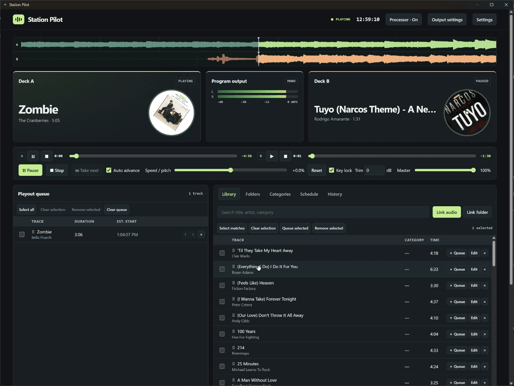
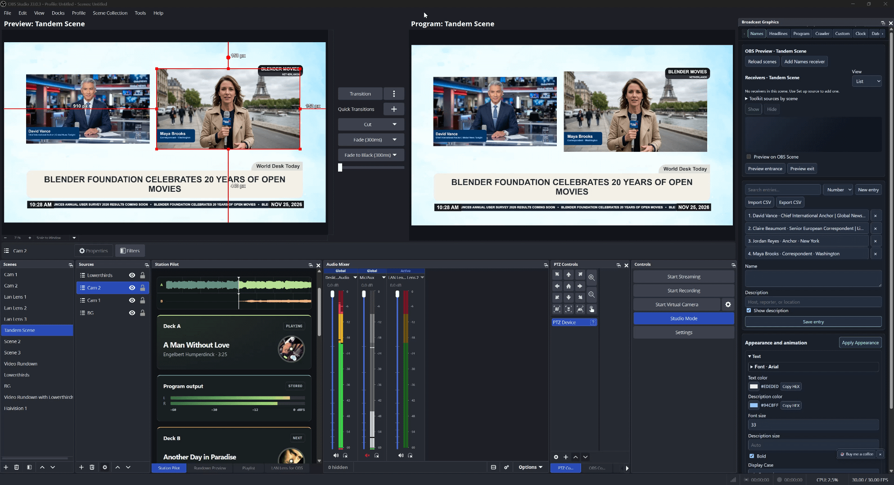

# Station Pilot

Station Pilot is an independently implemented, offline radio playout workstation for Windows, macOS, and Linux. It plays regular audio files and uses a local browser profile for storage, you can integrate it on OBS for direct playout.

## App Demo


## Demo on OBS Studio custom dock


# Support the project
[](https://ko-fi.com/bitwraith21)

## Install the desktop app

Station Pilot uses a Tauri 2 desktop window on Windows, macOS, and Linux. The Rust host embeds the interface and opens links to original audio files. The peak limiter and platter scratching run in Rust compiled to WebAssembly.

### Windows

Use the **Small MSI** on a 64-bit Windows 10 or 11 PC that already has Microsoft WebView2 Runtime. Use the **Offline MSI** to install with a bundled WebView2 runtime. Both open the same Station Pilot interface without a localhost server. If Station Pilot is running, setup asks before closing its window and stopping playout. Select **Launch Station Pilot** on the Finish screen to open it, or open it later from the Start menu.

### macOS and Linux

Extract the release archive for your operating system and processor. On macOS, double-click **Install Station Pilot.command** in Finder. On either system, open a terminal in the extracted folder and run:

```sh
sh install.sh
```

The install and uninstall scripts use Python 3.9 or later. Playout uses the system WKWebView on macOS or WebKitGTK 4.1 with GStreamer audio codecs on Linux. On macOS, the app shortcut appears under `~/Applications`. On Linux, use the desktop environment's application menu.

### Build and install from Git on Linux

On Zorin OS and other Ubuntu or Debian-based desktops with WebKitGTK 4.1 available, run `sh linux-install.sh` from the cloned source folder. It installs missing build packages through APT, sets up stable Rust, compiles the app, and adds a Station Pilot shortcut to your app menu. Run the script as your desktop user. It uses `sudo` when system packages need to be installed.

### Installation paths and uninstall

Close Station Pilot first. Open **Uninstall Station Pilot** from the Start menu or Linux application menu. On macOS, open **Uninstall Station Pilot.command** under `~/Applications`. On macOS and Linux you can also run `sh uninstall.sh` from the extracted setup folder. The prompt defaults to keeping data. Windows Settings removal keeps data automatically.

| Platform | App files | Saved data |
| --- | --- | --- |
| Windows | `%LOCALAPPDATA%\StationPilot\App` | `%LOCALAPPDATA%\StationPilot\Data` |
| macOS | `~/Library/Application Support/Station Pilot/app` | `~/Library/Application Support/Station Pilot/data` |
| Linux | `${XDG_DATA_HOME:-$HOME/.local/share}/station-pilot/app` | `${XDG_DATA_HOME:-$HOME/.local/share}/station-pilot/data` |

Saved data includes file and folder links, metadata, queue, schedules, settings, and history. Earlier releases may also have stored audio copies. Reinstalling under the same OS account and app data location reuses retained data. The Windows installer copies the legacy installed browser library into the embedded profile on first run and keeps the source copy. Audio and state from a development session in your everyday browser stay in that browser profile.

The Tauri app runs without a local HTTP server on all three systems. On macOS, WKWebView also stores the workstation database inside the app’s WebKit profile. When upgrading a Linux or macOS installation from the Chromium launcher, export settings in the old app first, then import them and relink music in the new app. Its library, queue, schedules, and history start in a separate WebKit profile.

For scripted removal on macOS or Linux, use `sh uninstall.sh --keep-data` or `sh uninstall.sh --remove-data`.

## OBS custom browser dock

Open **Settings → OBS Dock**, enable the local dock URL, and leave **Local port** blank to select a free port automatically. For a specific port, use **Check port** and then apply the settings. Copy the full URL into **OBS → Docks → Custom Browser Docks** on the same computer.

Turn on **Share this app’s settings and linked music** to mirror the desktop library and preferences. Manage shared settings and links in the desktop app. Older browser-only links may need to be relinked with the desktop picker. The dock keeps its own queue, schedules, and playback history, and uses the browser’s default output device in shared mode. With sharing off, the dock has independent settings and links. Its browser profile is tied to the port, so keep the same port to reopen that profile.

Choose **Keep running in the system tray** or **Ask every time** to keep the server available when closing the window. The tray menu can show or quit Station Pilot. Quitting shuts down the dock server. Tray availability on Linux depends on the desktop environment.

## Run from source

Use a current Chrome, Edge, Firefox, or Safari browser and Python 3. Open a terminal in this folder and run:

| System | Command |
| --- | --- |
| Windows | `py -3 serve.py` |
| macOS or Linux | `python3 serve.py` |

Open [Station Pilot on this workstation](http://127.0.0.1:8765). Keep the server and the playout tab open. The bundled server listens only on the loopback interface. Laragon is optional. If using Laragon, use a localhost URL, such as `http://localhost/station-pilot/`, and stick to that exact origin for subsequent sessions. A different host name, port, or browser profile has separate storage.

The frontend uses standard HTML, CSS, JavaScript, IndexedDB, and Web Audio. There are no npm, PHP, database, or cloud-service dependencies. Compatibility with older systems depends on the browser the OS can run. A browser needs IndexedDB, Web Audio, Web Locks, and native dialog support.

### Build the Rust host and audio module

From the source folder, use a Rust toolchain with the `wasm32-unknown-unknown` target:

```sh
rustc rust/dsp.rs --target wasm32-unknown-unknown --crate-type cdylib --edition 2021 -C opt-level=s -C strip=symbols -C panic=abort -o pilot_dsp.wasm
cargo build --release --locked --manifest-path rust/Cargo.toml
```

The Windows MSI build uses WiX 3 and the Rust Windows GNU target. It also runs the existing Windows Installer helper build. Use `packaging/windows/build.ps1` with `-Compact` for the system runtime edition, or pass an extracted fixed runtime folder with `-WebViewRuntime` for the offline edition. On macOS and Linux, build on the target OS and architecture with the native [Tauri prerequisites](https://v2.tauri.app/start/prerequisites/). After the Cargo build, package the native executable using:

```sh
python3 packaging/build-unix.py Station-Pilot.tar.gz --native-host rust/target/release/station-pilot
```

The native build workflow produces separate Linux x64, macOS Intel, and macOS Apple Silicon archives as GitHub Actions artifacts. The release publisher can attach those archives to a release.

## Playout

Windows remembers the original locations you link with the desktop picker. For links created before 0.3.4, choose the original folder or file in **Reconnect music** once. Linking or refreshing a folder indexes its audio recursively.

1. Choose **Link audio** or **Link folder**, or drop originals from a browser that exposes file handles. Station Pilot saves read-only references and plays the files from their original drive. Use **Folders** to browse, refresh, or relink a folder, and **Categories** to group tracks without moving them. New folder links index audio in subfolders. Earlier stored audio remains available unless removed from the library.
2. Drag tracks from the library into the queue. Drop above or below a row to insert at that position. Drag queued tracks to reorder them. Buttons and double-click-to-queue are also available. Use **Edit** for title, artist, category, and fallback eligibility.
3. Drop a song on either deck to cue it at the beginning. Start the decks independently with their **Play** buttons to mix them, or use **Take next** for a queue transition. **Stop** stops both decks and disarms automation. The individual deck stop buttons stop only that deck.
4. For fallback rotation, mark eligible cuts in **Edit** and enable **Use fallback rotation** in **Output settings**. With Auto advance enabled, the app cycles through eligible tracks once the queue is empty.
5. Use **Schedule** for one-time, daily, weekly, monthly, or yearly inserts. Dates that do not occur, such as February 29 in a non-leap year, are skipped. The scheduler checks the workstation's local clock and queues items during the selected minute. Scheduled inserts take priority over regular queue items after the current track. With transport stopped, the scheduled item waits for Play. If armed automation is already waiting for material, it can start a due insert from idle. Events missed while the tab is closed, suspended, or the scheduler is disabled are not replayed.
6. Open **History** for queue, scheduler, and deck activity. Playback entries include the deck and, where available, the track position. **Export CSV** writes the full activity history with UTC timestamps.

Right-click a track to assign a category, edit it, or cue it on either deck. Right-click a selected track to assign one category to the selected group. In the queue, right-click a row to insert **Stop and recue** before or after it. When automation reaches the marker, playback stops and the next queued track is cued for a manual start. **Est. start** uses the local clock, track lengths, and transition settings. Times after a stop are on hold.

**Speed / pitch** adjusts the active deck by up to ±16%. **Key lock** keeps the original pitch while the speed changes. Switch it off for vinyl-style varispeed. **Trim** adjusts the current deck before mixing and resets on the next track. Output settings include stereo or dual mono, and toggles for the platter artwork and rotation. The app reads embedded art from FLAC pictures, ID3 picture tags, M4A cover atoms, and Ogg/Opus picture comments.

Drag the program platter clockwise or counterclockwise to scratch the track. The gesture reads the actual audio samples in either direction. Release to resume from the new position if the deck was playing. Scratching needs AudioWorklet support and is available for files up to 12 minutes and 100 MB.

Deck A and Deck B each have a scrolling waveform with a fixed playhead. For tracks up to 12 minutes and 100 MB each waveform shows four seconds on each side. Longer recordings show recent audio as they play. The player uses timestamped mouse and touch movements and fades between normal playback and scratching.

In **Schedule → Add event**, search by title or artist, choose the track, and save the event. The same search is available when editing an existing event.

## Local listening and FM or AM audio

| Use | Signal path |
| --- | --- |
| Local | Browser output → speakers or headphones |
| FM studio | Browser stereo output → audio interface → studio console or broadcast processor |
| AM studio | Browser dual-mono output, or studio mono sum → audio interface → studio console or AM processor |

Choose an available audio device in **Output settings**. The device list depends on browser and operating-system permissions. On Windows, select **System default**, start playback, then open **Windows Volume Mixer** to route the app to an output missing from its list. Set a conservative master level and verify both channels on the physical console or processor in an off-air test.

Use **Settings → Settings backup** to export or import preferences as JSON. This includes master level, output, processor, platter, and automation preferences. Stop playout before importing. If the backed-up audio device is unavailable on this workstation, the current output stays selected. The library, queue, schedules, and history are stored separately.

The optional **Processor** has 20 presets and adjustable controls for high-pass filtering, three-band EQ, compressor threshold, ratio, attack, release, and makeup gain. Select a preset, adjust its controls, and choose **Apply processor** to use it. Roll the mouse wheel over a slider or number field to adjust it. Roll over a focused, closed dropdown to move between choices. An always-on sample-peak limiter targets a −3 dBFS ceiling on browsers with AudioWorklet support. The meter measures the internal program signal after processing and master gain. Transmitter-side processing, modulation, and monitoring remain in the station chain.

## Storage and operational limits

The import preview reads filenames as `Title - Artist` by default. Choose `Artist - Title` under **Filename order** for files that use that order. Linked folders remember the chosen order for future scans.

The app stores metadata, file handles, and automation data in IndexedDB. Linked audio stays on its original drive. Keep the drive connected for playout and reauthorize read access if your browser requests it. Station Pilot reads track durations in the background and saves them with the library metadata. Clearing site data or changing profiles can remove the saved library links. Only one tab on the same origin and profile can run the workstation at a time.

After a reload, the queue and settings are restored and the transport starts in standby. Keep the workstation awake and exclude the playout tab from browser sleep or memory-saving features during an automation run. A suspended tab can miss timing windows, and a crashed tab stops audio. The current version has one program output, fixed-duration crossfades, and no dedicated cue output. Validate codec support, long-running playback, interface recovery, and handoff to a backup source on each intended studio setup before live use.

## Public workflow references

- [OtsAV media library](https://docs.otslabs.com/OtsAV/help/using_otsav/media_library/media_library.htm)
- [OtsAV manual playlists](https://docs.otslabs.com/OtsAV/help/using_otsav/playlist_features/how_to_manually_build_a_playlist.htm)
- [OtsAV Auto DJ](https://docs.otslabs.com/OtsAV/help/using_otsav/control_features/mixing/auto_dj.htm)
- [Ots scheduling and logging](https://otslabs.ots7.com/omql-docs-osh/)

## Settings backups

Export JSON in Settings saves preferences, categories, linked folders, and linked track metadata. Import merges the links, reuses available bookmarks, and opens **Locate missing music** for sources that need a new location. You can reopen the locator from Settings. The backup stores references to the original audio. Settings-only JSON backups from earlier versions still import.
